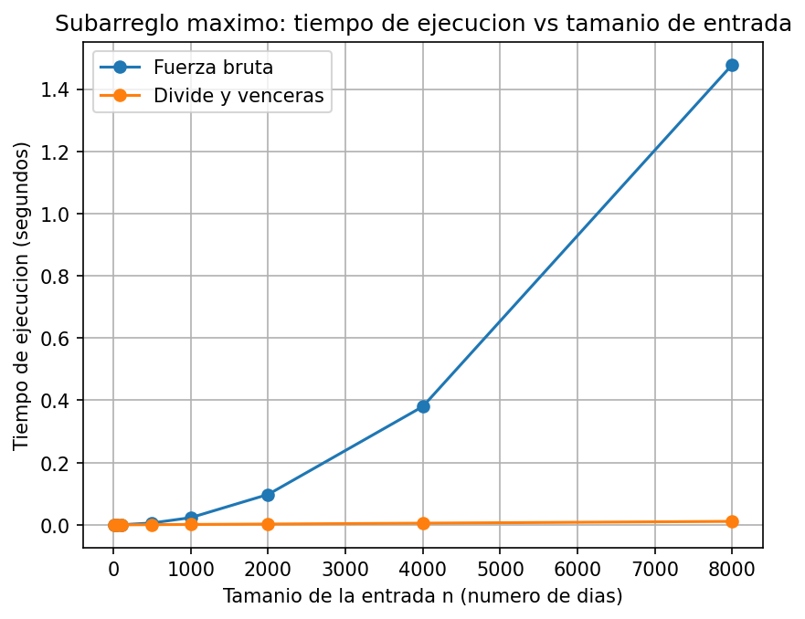

# Laboratorio: subarreglo máximo (fuerza bruta vs. divide y vencerás)

**Autor:** Felipe Ramirez Loaiza

Situación: una cooperativa de tiendas de barrio quiere hallar, para cada tienda, su mejor racha, es decir, el tramo de días consecutivos con la mayor variación acumulada de caja.

## Cómo reproducir el experimento

Desde la raíz del repositorio, active el entorno virtual `venv`.

```bash
# Linux / macOS
source venv/bin/activate

# Windows (PowerShell)
venv\Scripts\Activate.ps1

# Windows (Git Bash)
source venv/Scripts/activate
```

Si es la primera vez, instale las dependencias con `pip install -r requirements.txt`. Luego entre a /laboratorios/lab2-divide-y-vencer y ejecute:

```bash
python pruebas.py     # pruebas: debe imprimir todas las pruebas ejecutada.
python medicion.py    # medición: imprime la tabla de resultados y guarda graficas/tiempo_vs_n.png
```

## Parte 1 — Implementar y verificar

Código: [`subarreglo.py`](subarreglo.py) y [`pruebas.py`](pruebas.py).

`subarreglo.py` contiene subarreglo_fuerza_bruta, suma_cruzada y subarreglo_maximo.

`pruebas.py` verifica ambas soluciones con `assert`. Casos cubiertos:

- La serie de ocho días de la situación problema (suma 17, días 2 a 7).
- Un solo elemento, positivo y negativo.
- Todos los valores negativos y todos positivos.
- Un caso donde el mejor tramo cruza el punto medio.
- 20 listas aleatorias en las que ambas funciones deben dar la misma suma.

En cada caso se comprueba además que los índices devueltos sumen realmente lo reportado y que la lista original quede intacta.

## Parte 2 — Medir y graficar

Código: [`medicion.py`](medicion.py).



**Cómo se midió:**

- Tamaños: 10, 50, 100, 500, 1000, 2000, 4000, 8000.
- Para cada n se genera una sola lista (enteros entre -100 y 100, semilla 42) y se usa la misma para ambos algoritmos.
- Se cronometra solo la llamada al algoritmo con `time.perf_counter()`.
- Cada algoritmo se repite 3 veces por tamaño y se conserva el menor tiempo, que es el menos afectado por otros procesos del sistema.
- En cada tamaño se verifica con `assert` que ambos algoritmos devuelven la misma suma.

## Parte 3 — Análisis

### 1. Recurrencia

`subarreglo_maximo` hace dos llamadas recursivas sobre mitades de tamaño `n/2` (casos izquierdo y derecho). Además ejecuta `suma_cruzada`, que barre cada mitad desde el punto medio, es decir, los n elementos una sola vez: `Θ(n)`. Combinar los tres resultados y el caso base cuestan `Θ(1)`:

`T(n) = 2T(n/2) + Θ(n)`

Método maestro: `a = 2`, `b = 2`, `n^(log₂2) = n`. Como `f(n) = Θ(n)` es igual a `n^(log_b a)`, aplica el caso 2 (con `k = 0`), y su condición se cumple por igualdad. Resultado: `T(n) = Θ(n log n)`.

La fuerza bruta es `Θ(n²)` porque el ciclo externo fija `i`, el interno recorre `j` desde `i` hasta `n-1`, y cada iteración hace trabajo constante (`suma += valores[j]` y una comparación). Hay `n(n+1)/2 = Θ(n²)` pares. Al acumular la suma no hay tercer ciclo.

### 2. Lo medido contra lo esperado

La curva de fuerza bruta se curva hacia arriba y llega a 1,48 s con `n = 8000`. La de divide y vencerás casi no se despega del eje (0,011 s).

Para `n = 4000 → 8000`:

- **Fuerza bruta:** `0,3801 → 1,4781 s`, ×3,89. Se predice ×4 (`2²`). Coincide.
- **Divide y vencerás:** `0,00540 → 0,01119 s`, ×2,07. Se predice `2·log₂8000/log₂4000 ≈ 2,17`. Coincide, y es claramente distinto de ×4, así que no es cuadrático.

### 3. Tamaños pequeños

Sí hay cruce. Con `n = 10` gana la fuerza bruta (0.000004s contra 0.000009s). Con `n = 50` están casi empatadas (0.000054s contra 0.000049s), y desde `n = 100` gana claramente divide y vencerás (x1,9), con una ventaja que crece hasta ×18,3 en `n = 1000`.

Divide y vencerás no gana desde el principio porque dividir el problema también cuesta trabajo y hay que hacer muchas llamadas y guardar resultados en cada paso. La fuerza bruta es más simple. Con pocos datos, la diferencia entre los dos métodos es pequeña y ese trabajo extra de dividir pesa más. Con muchos datos, la fuerza bruta se vuelve mucho más lenta y divide y vencerás pasa a ser más rápido.

### 4. ¿Cuándo conviene dividir?

Para encontrar el máximo de un arreglo, si lo divido en dos mitades, cada mitad es un problema más pequeño y juntar las dos respuestas solo cuesta una comparación (quedarse con la mayor). Eso se escribe `T(n) = 2T(n/2) + 1`, y el resultado es que el tiempo crece en línea recta, `Θ(n)`. Pero recorrer el arreglo una sola vez ya tarda lo mismo. Así que dividir no mejora nada: se hacen las mismas comparaciones y encima se gasta tiempo en las llamadas recursivas.

En el subarreglo sí conviene dividir. Hacerlo directo es lento (`Θ(n²)`) y juntar las mitades cuesta poco (`Θ(n)`), así que dividir ahorra mucho tiempo. Dividir ayuda cuando la forma directa es lenta. Si la forma directa ya es rápida, como en el máximo, no hay nada que ahorrar.

### 5. Concepto para la gerente

Se recomienda divide y vencerás. Con 1.500 tiendas de 2.000 días la diferencia aún es manejable (≈2,3 minutos en total con fuerza bruta contra ≈4 s), pero con series de cientos de miles o millones de registros la fuerza bruta deja de ser viable.

**Estimación:** se ajusta una constante a cada modelo con `n = 8000` y se evalúa en `n = 1.000.000` de registros (`10⁶`).

- Fuerza bruta: `c = 1,546 / 8000² ≈ 2,4·10⁻⁸ s`, entonces con 1.000.000 de registros `T ≈ c · (10⁶)² ≈ 24.000 s`, unas 6,7 horas.
- Divide y vencerás: `c = 0,01182 / (8000·log₂8000) ≈ 1,1·10⁻⁷ s`, entonces con 1.000.000 de registros `T ≈ c · 10⁶ · log₂10⁶ ≈ 2,3 s`.
